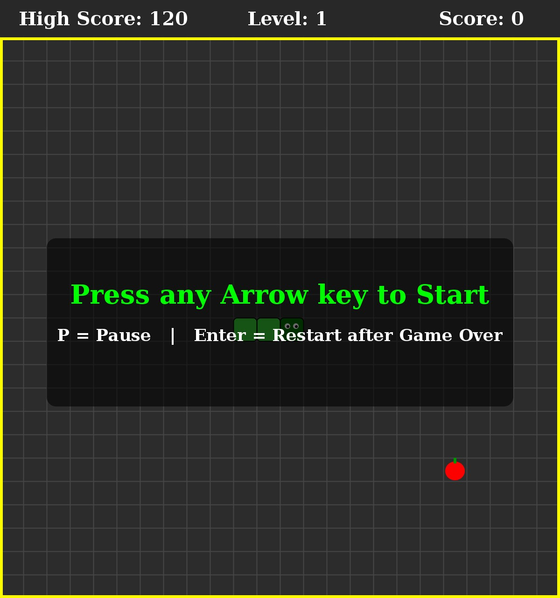
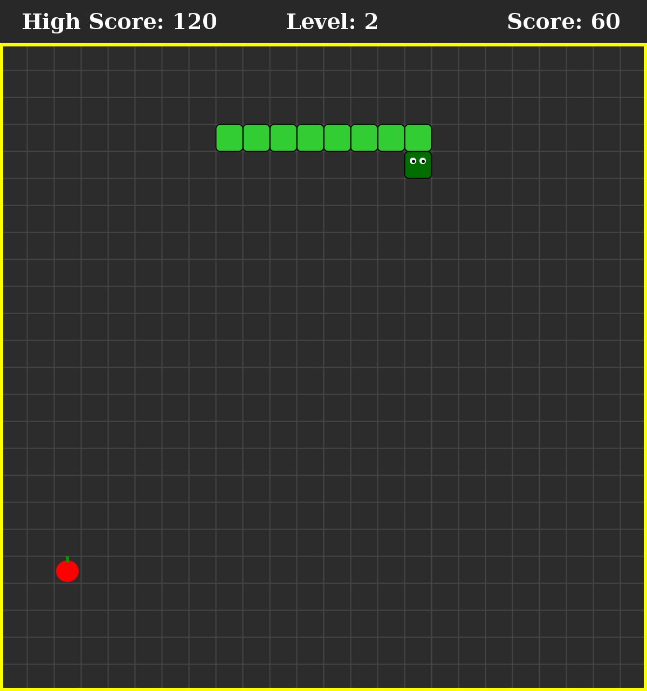
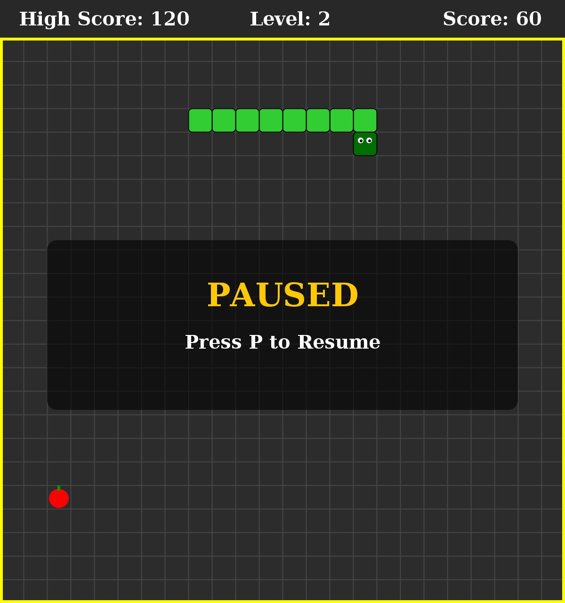
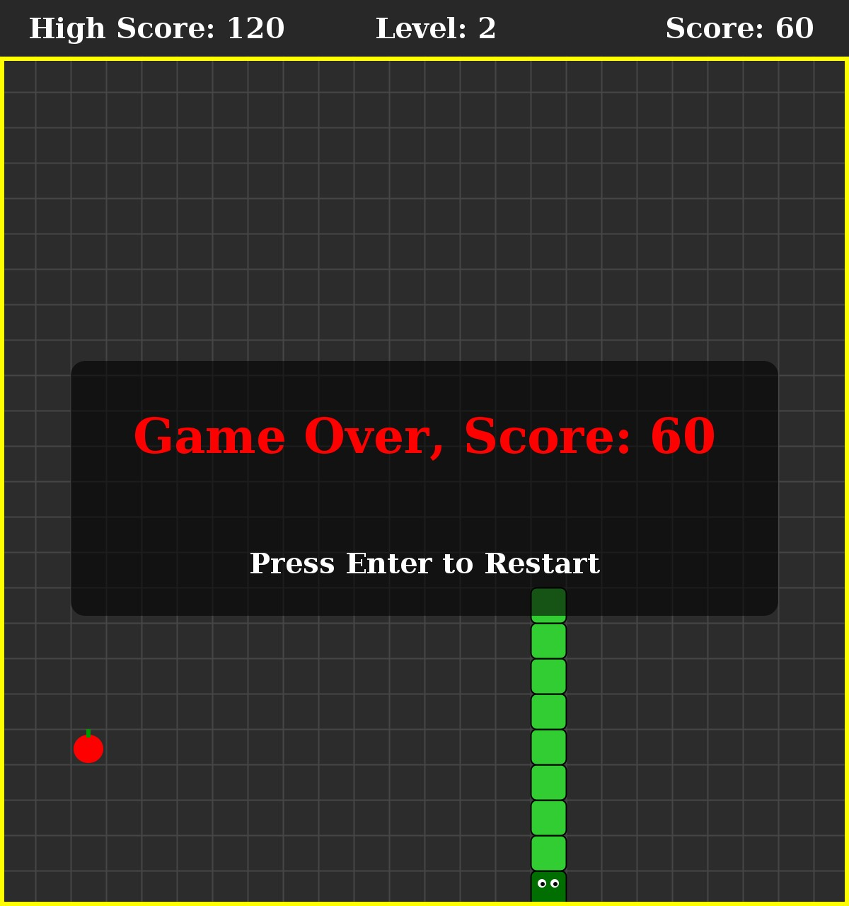

# Snake Game using Java ????

A classic, full-featured desktop Snake Game developed in **Java** utilizing **Java Swing** and **Java AWT**. This project was designed and implemented as an academic mini-project for the Department of Computer Technology, Yeshwantrao Chavan College of Engineering (YCCE), Nagpur.

The project demonstrates core **Object-Oriented Programming (OOP)** paradigms?Abstraction, Inheritance, Polymorphism, Encapsulation?along with Collections Framework, File I/O for persistent high-score tracking, robust Exception Handling, and event-driven architecture with Swing Timers and KeyListeners.

---

## ????? Student & Academic Information

| Field | Details |
| :--- | :--- |
| **Student Name** | Swaraj Surendra Pakhale |
| **Roll Number** | 172 |
| **Enrollment Number** | 24070241 |
| **Degree / Branch** | B.Tech in Computer Technology (Section CT-B) |
| **Institution** | Yeshwantrao Chavan College of Engineering (YCCE), Nagpur |
| **Academic Year** | 2026?2027 |

---

## ? Features

- **Smooth Grid-Based Movement**: 24?24 grid (600?600 board pixels) with 25px cell size.
- **Dynamic Difficulty & Speed**: Game starts at Level 1 (120ms delay). Every 5 food items collected (+50 score) advances the level and speeds up the snake (delay reduces by 10ms down to a minimum of 60ms).
- **Persistent High Score**: Highest score is read from and saved to `highscore.txt` automatically.
- **Pause & Resume**: Toggle pause anytime by pressing `P`.
- **Accurate Collision Detection**: Instant detection for wall collisions and self-intersections (with proper tail clearance).
- **Visual Feedback**:
  - High score, current level, and live score displayed on an elegant dark top banner.
  - Realistic snake rendering with distinguished head (darker green with dual white/black eyes).
  - Apple food rendering with vibrant crimson body and green stem.
  - Informative overlay screens for Start, Pause, and Game Over.
- **Easy Replayability**: Hit `Enter` immediately after Game Over to reset and restart.

---

## ??? Controls

| Key | Action |
| :--- | :--- |
| `?` or `W` | Move Snake Up |
| `?` or `S` | Move Snake Down |
| `?` or `A` | Move Snake Left |
| `?` or `D` | Move Snake Right |
| `P` | Pause / Resume Game |
| `Enter` | Restart Game (after Game Over) |

> **Note:** The game waits for the player's first arrow or WASD key press before the snake starts moving. Opposite direction presses (e.g., pressing Down while moving Up) are automatically ignored to prevent accidental suicide.

---

## ?? Screenshots

| 1. Game Start Screen | 2. Gameplay in Progress |
| :---: | :---: |
|  |  |
| *24?24 grid with start prompt and score bar* | *Snake growing with score & dynamic level progression* |

| 3. Paused Screen | 4. Game Over & High Score |
| :---: | :---: |
|  |  |
| *Press P to freeze/resume game loop* | *Collision detection with high score record notification* |

---

## ??? Object-Oriented Architecture & Concepts

This project was built from the ground up to showcase clean OOP and software design principles:

### 1. Abstraction
- The abstract base class `GameObject` defines common spatial attributes (`x`, `y`, `SIZE`) and declares the abstract method `public abstract void draw(Graphics g);`.

### 2. Inheritance
- `SnakeSegment` and `Food` extend `GameObject`, inheriting coordinate state and reusing common dimensions while specializing behaviors.

### 3. Polymorphism (Method Overriding)
- Both `SnakeSegment` and `Food` override `draw(Graphics g)` to render distinct shapes, colors, eyes, and stems using Java 2D Graphics.

### 4. Encapsulation
- Data fields (`head`, `snake`, `timer`, `highScore`, `delay`, `direction`) are private and manipulated exclusively through validated methods (`setHead()`, `relocate()`, `initGame()`).

### 5. Collections Framework
- `ArrayList<SnakeSegment>` manages dynamic snake body growth, head insertions at index `0`, and tail removals.

### 6. File Handling & Exception Handling
- High scores are persistently loaded and saved via `BufferedReader` and `BufferedWriter` to `highscore.txt`, wrapped in defensive `try-with-resources` blocks to ensure fail-safe execution.

### 7. Event-Driven GUI & Concurrency
- Uses `javax.swing.Timer` for continuous, smooth game loop ticks without freezing the UI.
- Implements `KeyListener` for responsive, non-blocking keyboard input.
- Launched safely on the Swing Event Dispatch Thread (EDT) via `SwingUtilities.invokeLater()`.

---

## ?? Project Structure

```
snake-game-java/
??? .gitignore               # Excludes compiled binaries, IDE metadata
??? README.md                # Comprehensive project documentation
??? highscore.txt            # Persistent high score data file
??? SnakeGame.java           # Standalone single-file Java source code
??? src/
?   ??? SnakeGame.java       # Standard IDE source folder structure
??? screenshots/
    ??? game_start.jpg       # Initial welcome / start screen
    ??? game_running.jpg     # Active gameplay screenshot
    ??? game_paused.jpg      # Pause overlay screenshot
    ??? game_over.jpg        # Game Over screen with high score
```

---

## ?? How to Compile & Run

### Prerequisites
- **Java Development Kit (JDK 8 or higher)** installed.
- Verify installation by running:
  ```bash
  java -version
  javac -version
  ```

### Option 1: Direct Terminal Compilation (Quickest)

1. Clone or download this repository:
   ```bash
   git clone https://github.com/swarajpakhale/snake-game-java.git
   cd snake-game-java
   ```

2. Compile the Java file:
   ```bash
   javac SnakeGame.java
   ```

3. Launch the game:
   ```bash
   java SnakeGame
   ```

### Option 2: Using Any IDE (IntelliJ IDEA, Eclipse, VS Code, NetBeans)
1. Open the repository folder in your favorite IDE.
2. Mark the `src` folder as **Sources Root** (if prompted).
3. Open `SnakeGame.java` and click **Run** (or press `Shift + F10` / `F5`).

---

## ?? License
This project is open-source and developed for educational purposes under the Department of Computer Technology at YCCE, Nagpur. Feel free to use, modify, and learn from it!
